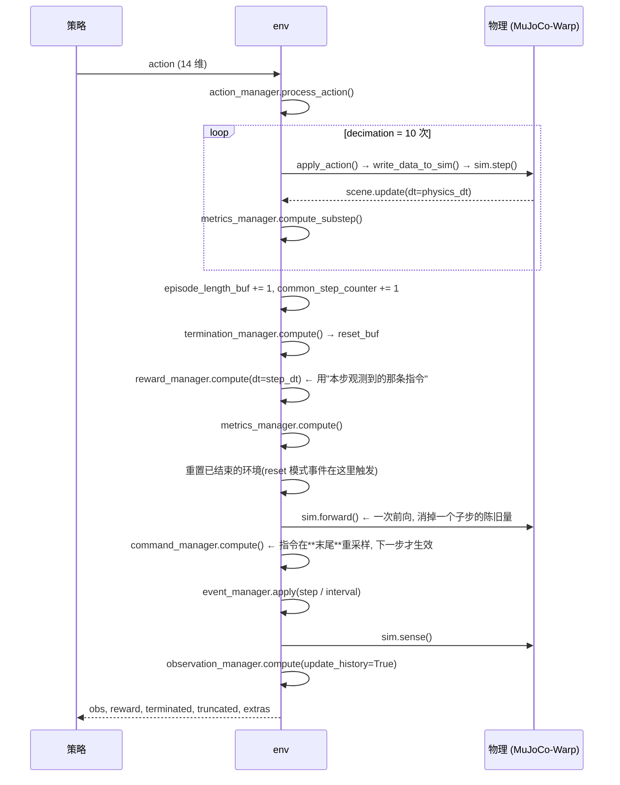

# 架构

## 三个层次

本仓库把"机器人 + 任务 + 训练"拆成三层，**改任何东西之前先确认自己改的是哪一层**：

| 层 | 在哪 | 谁负责 | 改它的后果 |
|---|---|---|---|
| 物理与框架 | `mjlab`（第三方包，`pyproject.toml` 里 pin 版本） | 场景/管理器/PPO/查看器 | 一般不改；要改先看 [失败模式史](failure-modes.md) 里的兼容性坑 |
| 任务与资产 | `src/mjlab_microduck/`、`assets/microduck/` | 本仓库 | 决定"学什么" —— 绝大多数问题在这里 |
| 训练产物 | `logs/rsl_rl/<experiment>/<时间戳>_<run-name>/` | 训练脚本 | 只读；checkpoint 用 `scripts/eval_walk.py` 之类回放 |

## mjlab 的"五件套 + 管理器"

一个 mjlab 环境（`ManagerBasedRlEnv`）不是一个写完的类，而是**一组配置**拼出来的。
"五件套"是必须想清楚的五件事，另外四个管理器是可选增强：

| 部件 | 配置字段 | 回答的问题 | 本仓库在哪定义 |
|---|---|---|---|
| 场景 | `cfg.scene` | 世界里有什么（机器人、地形、传感器） | `microduck_*_cfg.py` 的 `scene=SceneCfg(...)` |
| 观测 | `cfg.observations` | 策略能看见什么（分 actor / critic 两组） | 同上 |
| 动作 | `cfg.actions` | 策略能指挥什么（关节位置目标） | 同上 |
| 奖励 | `cfg.rewards` | 什么算好（每项一个函数 + 权重） | 同上（本项目最常改的一块） |
| 终止 | `cfg.terminations` | 什么时候回合结束 | 同上 |
| 指令 | `cfg.commands` | 任务要它做到什么（速度指令等） | 速度任务有，站立/坐站没有 |
| 事件 | `cfg.events` | 什么时候改物理/状态（域随机化、推力、重置） | 同上 |
| 课程 | `cfg.curriculum` | 难度怎么随时间上升 | 同上 |
| 指标 | `cfg.metrics` | 额外记录什么曲线（例如指令跟踪误差） | 同上 |

每个部件都是"**项名 → 配置对象**"的字典，名字会出现在日志里（`Episode_Reward/<项名>`），
所以命名本身就是可观测性的一半。

## 文件职责（一句话版）

| 文件 | 行数 | 职责 |
|---|---|---|
| `src/mjlab_microduck/tasks/__init__.py` | 46 | 把三个任务注册进 mjlab 的注册表（`register_mjlab_task`），并重新导出 cfg 函数方便测试 |
| `src/mjlab_microduck/tasks/microduck_cfg.py` | 233 | 站立任务 + **共享的机器人实体配置**（MJCF 选择、BAM 执行器参数） |
| `src/mjlab_microduck/tasks/microduck_sit2stand_cfg.py` | 165 | 坐→站任务 |
| `src/mjlab_microduck/tasks/microduck_walk_cfg.py` | 1406 | 平地速度跟踪；**顶部 docstring 就是本项目的实测记录本**（P0/P1/P2/P3 各轮修正与数字） |
| `assets/microduck/*.xml` | — | 机器人 MJCF 的多套变体（碰撞面/几何近似不同），见 [机器人资产](robot.md) |
| `scripts/*.py` | 89~521 | 评估与探针：量步态、量摇头、验随机化是否生效、跑上游策略做对照 |
| `tests/*.py` | 26~916 | 质检台：钉住静默错误，见 [测试](testing.md) |

## 一次 `env.step()` 里发生了什么

这是本项目最值得背下来的一段顺序 —— 因为它决定了"指令、奖励、随机化"三者的相位关系。
（下面每条都对应 `mjlab/envs/manager_based_rl_env.py` 的 `step()`。）

几条容易搞错的推论：

- **指令不错位**：指令在 `step()` 末尾重采样，而奖励在同一步的中间算。所以"本步奖励用的指令"
  就是"策略本步在观测里看到的那条指令"；新指令从下一步的观测开始生效。
- **`common_step_counter` 每次 `step()` 只 +1**（所有环境一起走），所以**课程推进速度只跟
  iteration 数有关、跟 `num_envs` 无关**：`num_steps_per_env=24` 时，无论 16 还是 4096 个环境，
  1 个 iteration 都只让课程前进 24 步。（想按"训练量"推进课程，得自己换算。）
- **奖励是 dt 缩放的**：RL 拿到的每步奖励 = `Σ 各项加权值 × step_dt`。
- **重置在奖励之后**：本步的奖励仍按"结束前那一瞬"的状态算，不会用到重置后的状态。

## 时间常数与规模

| 量 | 值 | 出处 |
|---|---|---|
| 物理步长 `timestep` | 0.002 s | `microduck_walk_cfg.py` `SimulationCfg(mujoco=MujocoCfg(timestep=0.002))` |
| `decimation` | 10 | 同上 |
| 控制周期 `step_dt` | **0.02 s（50 Hz）** | `timestep × decimation` |
| `njmax` | 300 | 同上（并发约束上限；太小会在复杂接触时静默退化） |
| `contact_sensor_maxmatch` | 64 | 同上（接触传感器每帧最多匹配的几何对数） |
| 回合长度（walk） | 20 s = 1000 步 | `episode_length_s=20.0` |

## 观测契约（最容易被静默改坏的地方）

观测分两组：`actor`（策略真实能拿到的、上真机也能算出来的）和 `critic`（训练期可以多给的信息）。
**两组的维度不必相同，但同一项在两组里的顺序必须一致**，否则续训/蒸馏会错位。

三个任务的实测契约（维度是数出来的，不是抄注释）：

| 任务 | actor | critic | 说明 |
|---|---|---|---|
| 行走 `Mjlab-Velocity-...` | **51** = joint_pos 14 + joint_vel 14 + gravity 3 + ang_vel 3 + actions 14 + **command 3** | **54** = 上面 51 + base_lin_vel 3 | 真的给了 critic 特权信息（实测机体线速度）；actor 里**没有**线速度 |
| 站立 `Mjlab-Stand-...` | **51** = joint_pos 14 + joint_vel 14 + gravity 3 + ang_vel 3 + actions 14 + **base_lin_vel 3** | **51**（`dict(actor_terms)` 直接复制） | ⚠️ **critic 没有额外特权信息** —— 两组完全一样，而 actor 里有真机给不出的机体线速度 |
| 坐→站 `Mjlab-Sit2Stand-...` | 同站立 51 | 同站立 51 | 同上 |

::: warning 两条由此而来的结论

1. **站立/坐站任务的 actor 含 `base_lin_vel`**（`root_link_lin_vel_b`）—— 这是真机上拿不到的
   （没有速度传感器），部署时必须用状态估计替换。行走任务已经把它挪到 critic 了。
2. 两个任务的 critic 都是 actor 的拷贝 ⇒ **它们没有特权 critic**，PPO 的非对称 actor-critic
   在这两个任务上等于没启用。（要不要补、怎么补，见 [路线图](roadmap.md) 的 W4。）

:::

::: danger 一个会静默错训的坑（已写进测试）

站立任务的 actor 也是 **51 维**，但**最后 3 维的语义不同**：
站立 `actor[48:51]` = 实测机体线速度（`base_lin_vel`），行走 `actor[48:51]` = **速度指令**。
用 `--agent.resume` 加载站立 checkpoint 去续训走路时，形状能对上、**不会报错**，
策略却会把"指令"当"实测速度"读。测试 `test_actor_obs_tail_is_the_command_slot` 钉住了这件事。

:::

## 奖励与指标的口径（对数前必须知道）

`eval_walk.py` 和训练日志用的是**不同**的口径，混着比会得出相反结论：

| 口径 | 怎么算 | 用在哪 |
|---|---|---|
| RL 奖励/步 | `Σ (各项值 × 权重) × step_dt` | PPO 实际优化的量（`scale_rewards_by_dt` 默认 True） |
| `env.reward_manager._step_reward` | `Σ (各项值 × 权重)`，**未乘 dt** | headless 评估里"每步真实量级"，与训练曲线同量级对比时用它 |
| `Episode_Reward/<项名>` | 该项**整回合累计 / `max_episode_length_s`** = 每秒平均贡献 | TensorBoard / wandb 的曲线 |
| `Metrics/<...>` | `cfg.metrics` 里定义的量（例如指令跟踪误差） | 训练日志 |

⚠️ 分母 `max_episode_length_s` **是每个任务自己的**：行走 20 s、站立 **10 s**、坐→站 20 s。
所以跨任务比较 `Episode_Reward` 的绝对值没有意义（同一个行为在站立任务里会被放大 2 倍）。
回合早终止时它也会被压小（分子短了、分母不变）—— 这正是"曲线骗人"的主要来源。

::: tip 比较奖励时比"质量"不比"权重"

`air_time` 权重 3.0 与 `track_lin_vel` 权重 2.0 谁更重要，**不能看权重**，要看它们实际贡献了多少分：
headless 实测（`scripts/eval_walk.py --terms`，vx=0.15，第 3250 轮 checkpoint）：
`air_time +2.51`、`upright +1.97`、`track_lin_vel +1.90`、`track_ang_vel +0.51`，
而全部负项合计只有 `-0.365`（其中 `body_ang_vel -0.00`）。
结论方式也由此而来：**奖励项只有跑完一次 rollout、把每一项的分数打出来，才算真的设计过。**

:::