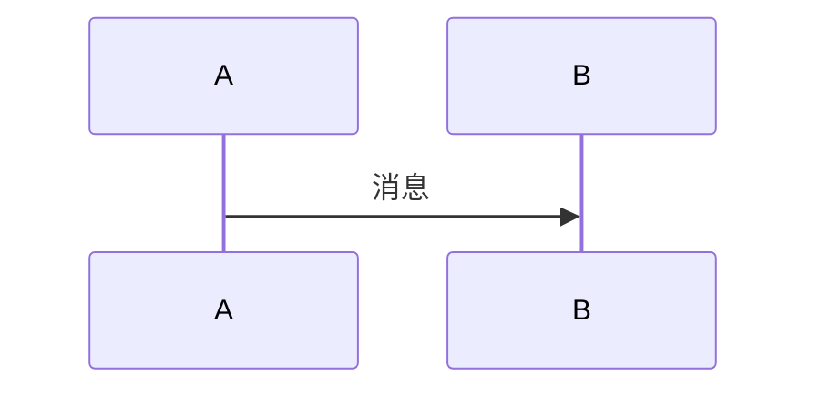

# 文档工具说明

## 结论

用 **VitePress**，文档放在 `docs/*.md`，用 **GitHub Actions 部署到 GitHub Pages**
（`.github/workflows/docs.yml`）。

站点配置只有一个文件：`docs/.vitepress/config.mts`。那里写站点标题、顶部导航、左侧目录、
以及搜索插件 —— 除此之外没有别的配置。

**不做 API 自动生成**。原因见文末"为什么不做 API 自动生成"。

## 为什么是 VitePress

| 候选 | 为什么不选 / 为什么选它 |
|---|---|
| **VitePress** ✅ | 文档就是**纯 Markdown**（在 GitHub 文件页上直接可读，没有锁定）；默认主题自带侧边栏、明暗切换、代码高亮与复制、以及**离线全文搜索**（不需要 Algolia 之类的服务）；构建只依赖 4 个 JS 包，**不需要 torch/mujoco/mjlab** ⇒ CI 里几十秒建完，且和"物理库在 aarch64/cuda 上装不装得起来"彻底解耦；`base` 一设就能部署到 GitHub Pages 的子路径 |
| MkDocs (+ Material) | 功能没问题，但配置面太大：要达成同样的效果得维护 `markdown_extensions` 十几个条目、`plugins`、`theme.features` 一长串，而这些在 VitePress 里默认就有。**本仓库 2026-10 就是从它迁过来的** |
| Docusaurus | 功能最全（版本化/博客/i18n），但对"内部工程文档"来说太重，配置项比 MkDocs 还多 |
| Astro Starlight | 默认设计与性能都很好，但中文搜索要靠 Pagefind 且不如 VitePress 这套中文分词成熟，生态也小一些 |
| mdBook | 轻快，但插件生态弱、中文搜索要自己配 |
| GitHub Wiki | 零工具，但**是另一个仓库** ⇒ 不能跟代码一起 review、不能跟着 PR 走；没有本地预览 |
| 只在 README 里堆 | 就是更早的状态：README 已经几百行、混了导航/命令/路线图/实测记录，再加就没人读了 |

一句话：**这仓库缺的不是"文档生成能力"，是"分页、可搜、能跟 PR 一起 review"**，
VitePress 正好只做这件事，而且不逼你放弃 Markdown。

## 目录约定

```
package.json / package-lock.json  ← 站点依赖（只有 4 个包，全是 devDependencies）
docs/                             ← VitePress 的 root，内容仍在这里
  .vitepress/config.mts           ← 站点配置 + 顶部导航 + 左侧目录 + 搜索插件
  .vitepress/theme/index.ts       ← 唯一的主题代码：mermaid 图渲染（约 40 行）
  public/favicon.svg              ← 原样复制到站点根目录的静态文件
  index.md / architecture.md / …  ← 正文
  tasks/{index,stand,sit2stand,walk}.md
.github/workflows/docs.yml        ← 构建 + 部署到 Pages
```

**所有页面都是给 GitHub 看的普通 Markdown**：`docs/architecture.md` 在 GitHub 网页上渲染正常，
站内链接用相对路径（`[架构](architecture.md)`），代码块两边都高亮。
换句话说：**哪天不想用 VitePress 了，把 `.vitepress/` 和 `package.json` 删掉也不损失任何内容。**

## 本地预览

```bash
npm ci                # 首次（或依赖变了之后）
npm run docs:dev      # 起本地服务器, 改文件自动刷新
```

浏览器打开 **`http://localhost:5173/base-sim/`** —— 注意地址里带 `/base-sim/` 前缀，
这是 `config.mts` 里 `base` 造成的，**是正常的**，不是配错了。

`--host 127.0.0.1` 不是多余的：不加的话 Vite 只监听 IPv6 的 `[::1]`，
而本机如果开着 HTTP 代理（`http_proxy=127.0.0.1:7890` 这类），代理走 IPv4 连不上，
浏览器就会看到 **502 Bad Gateway** —— 看着像服务器挂了，其实只是没绑到 IPv4。
（`docs:preview` 监听的是 `*`，所以它不受影响。）

::: warning 搜索在 dev 模式下用不了，要看搜索得用 preview
pagefind 的索引是**构建时**生成的，所以 `docs:dev` 里点搜索只会看到一条占位结果
（"只在构建后才生效 / only support after build"）—— 这不是坏了。

要验证搜索，用下面这两条，浏览器开 `http://localhost:4173/base-sim/`：
:::

```bash
npm run docs:build     # 只构建 —— 这就是 CI 用的检查
npm run docs:preview   # 预览构建产物（http://localhost:4173/base-sim/）
```

**`docs:build` 会在内链写错时直接失败**，这是它最重要的作用（等价于原来的 `mkdocs build --strict`）。

::: warning 死链检查有个缺口，和 MkDocs 不一样
VitePress 会检查**正文里的 Markdown 链接**（写错就构建失败），但**不检查
`config.mts` 里 `nav` / `sidebar` 的链接** —— 那里写错会绿灯通过、运行时 404。

原来的 `mkdocs build --strict` 两者都管。所以**改导航之后要手动点一遍**（`docs:preview` 最方便）。
:::

## 部署到 GitHub Pages

工作流已经写好（`.github/workflows/docs.yml`），行为是：

- **push 到 `main`** 且改到 `docs/**` / `package.json` / 工作流本身 → 构建 + 部署
- **PR** → 只构建不部署（外部贡献者改文档不会碰线上站点）
- 也可以在 Actions 页面手动 `workflow_dispatch`
- 权限用 GitHub 官方的 Pages 三件套（`pages: write` + `id-token: write` + `contents: read`），
  **不需要个人访问令牌**
- checkout 用了 `fetch-depth: 0`：页面上的"最后更新"时间和搜索索引都要从 git 历史取时间戳，
  浅克隆会拿到空白时间（构建照样成功，所以不看就发现不了）

::: warning 一次性仓库设置（必须由人在网页上点一下）
`Settings → Pages → Build and deployment → Source` 选 **`GitHub Actions`**。
没设这个，工作流会在 `deploy` 步失败（构建本身会成功）。
站点地址是 `https://deepstone-robot.github.io/base-sim/` —— 对应 `config.mts` 里的 `base: '/base-sim/'`，
**两者必须一致**。
:::

推送与部署是**对外可见的动作**，所以要由你来决定何时执行。

## 提示框（admonition）怎么写

VitePress 用 `:::` 容器，**正文不要缩进**（这点和 MkDocs 的 `!!!` 相反 —— 那边正文必须缩进 4 格）：

```text
::: danger 标题写在这里
正文从第一列开始，不要缩进。
:::
```

可用的类型**只有这五种**（VitePress 默认主题注册的）：

| 类型 | 用途 |
|---|---|
| `tip` | 技巧、结论 |
| `info` | 背景说明 |
| `warning` | 会出问题但没到灾难级 |
| `danger` | 静默错训 / 静默 no-op 这类必须看见的坑 |
| `details` | 可折叠，标题同样写在类型后面（`::: details 标题`），点一下展开 |

::: danger 别用别的类型名
`note` / `success` / `quote` 这些 MkDocs 里有的类型，VitePress **没有注册** ——
写了不会报错，而是**原样把 `::: note` 显示成一行文本**。这是迁移时最容易漏的坑，
本仓库原来的 25 个提示框里有 2 个就属于这类（已重映射成 `tip` / `info`）。
:::

## Mermaid 图怎么画

直接写围栏即可，主题里已经接好了（`docs/.vitepress/theme/index.ts`）：

````text

````

几点说明：

- 图是**浏览器端渲染**的，构建产物里存的是源码 —— 所以 `grep` 构建产物只能看到 `language-mermaid`，看不到 SVG
- **源码不要缩进**（顶层围栏，和正文一样从第一列开始）
- 明暗主题切换时会自动重绘；渲染失败只丢图，退回显示源码，不影响阅读
- 构建时有一条无害警告 `language 'mermaid' is not loaded, falling back to 'txt'` ——
  VitePress 的语法高亮器不认识 mermaid，会先当纯文本处理，之后由上面那段主题代码接管

## 为什么不做 API 自动生成

`mkdocstrings` 那类工具能从 docstring 生成 API 页，对本仓库**理论上**很有吸引力 ——
这个仓库的 docstring 里全是实测记录（`microduck_walk_cfg.py` 顶部那 200 行就是记录本）。
但有两个现实问题：

1. **它会拖进整个训练依赖**：导入 `mjlab_microduck` 就要把 `mjlab` / `mujoco` / `torch` 全装上，
   文档 CI 从"几十秒"变成"几分钟 + 平台轮子风险"，而文档站本身根本不需要这些。
2. **docstring 不是给人读的格式**：那些记录的写法是"第几轮、什么现象、量到什么数、怎么修的"，
   适合当**散文**引用（本站确实大量引用，但都是人工摘录 + 交叉核对过行号的），
   自动生成的 API 页会把它们塞在签名下面，反而更难读。

所以现在的做法是：**人工写模块页 + 需要时摘录 docstring**。真要用的时候（比如以后模块变多、
签名成为主要信息），再单独开一个 `reference/` 分页，并接受"文档 CI 需要装训练依赖"这个代价。

## 写文档的约定（本仓库自己的三条）

1. **每个数字都要有出处**。要么给脚本命令（能复现），要么标"docstring 声称（未复跑）"。
   本站里"实测"与"声称"是分开写的 —— 见 [评估与探针](evaluation.md) 的说明。
2. **写清"为什么"，不只写"是什么"**。改一个权重之前，读者应该能在这套文档里找到
   "上一版是多少、量到了什么、为什么改"。这也是 [失败模式史](failure-modes.md) 存在的理由。
3. **陷阱要单独标出来**。凡是"配置能跑通、训练不报错、但结果不对"的东西（静默 no-op、
   静默错训、静默物理变化），都用 `::: danger` / `::: warning` 块写在相关页面上，
   并尽量配一个测试去钉住它（见 [测试](testing.md)）。
